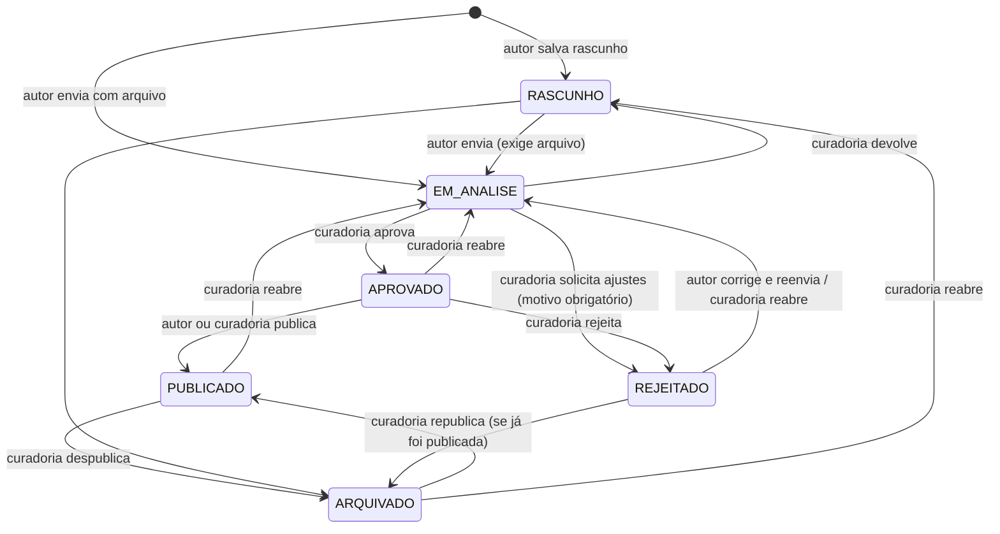

# Regras de negócio

Implementação central: `api/src/services/work-policy.ts` (permissões e transições) e `api/src/services/works.service.ts` (efeitos de cada status). Mantenha este documento sincronizado com esses arquivos.

## Ciclo de vida de uma obra

| Status | Rótulo na interface | Visível no catálogo |
| --- | --- | --- |
| `RASCUNHO` | Rascunho em Edição | não |
| `EM_ANALISE` | Em Análise | não |
| `APROVADO` | Aprovado pelo Comitê | não (pronta para lançar) |
| `PUBLICADO` | Publicado | **sim** |
| `REJEITADO` | Ajustes Solicitados | não |
| `ARQUIVADO` | Arquivado | não |

### Efeitos de cada transição

- **→ EM_ANALISE:** exige arquivo da obra (`422` sem arquivo). Define `submitted_at`, limpa motivo de rejeição, cria o checklist padrão (4 itens) se ainda não existir ou volta para `PENDENTE` os itens não aprovados.
- **→ APROVADO:** marca todos os itens do checklist como `APROVADO` (Etapa 2 concluída) e define `reviewed_at`.
- **→ REJEITADO:** exige motivo (`reason`), exibido ao autor no painel e na tela de análise.
- **→ PUBLICADO:** exige arquivo; define `published_at` na primeira publicação (republicar mantém a data original).
- **ARQUIVADO → PUBLICADO:** só é possível se a obra já foi publicada antes.

Etapas mostradas ao autor: **1** Recebimento do arquivo (concluída com `submitted_at`), **2** Revisão & testes de acessibilidade (checklist), **3** Aprovação final (`APROVADO`/`PUBLICADO`). O botão "Publicar" fica bloqueado até a Etapa 3.

## Quem pode fazer o quê

| Ação | Autor (dono) | Outro usuário | ADMIN |
| --- | --- | --- | --- |
| Ver obra/arquivo publicado | ✅ | ✅ (inclusive visitante) | ✅ |
| Ver obra/arquivo não publicado | ✅ | ❌ (`404`) | ✅ |
| Criar obra | ✅ (como autor) | — | ✅ (em nome de qualquer autor) |
| Editar tudo (inclusive arquivo) | só em `RASCUNHO`/`REJEITADO` | ❌ | ✅ sempre |
| Editar metadados (subtítulo, sinopse, notas, tags, rótulo, capa) | também em `APROVADO`/`PUBLICADO` | ❌ | ✅ |
| Editar em `EM_ANALISE`/`ARQUIVADO` | ❌ (`403`) | ❌ | ✅ |
| Enviar para análise | de `RASCUNHO`/`REJEITADO` | ❌ | ✅ (transição) |
| Publicar | só de `APROVADO` | ❌ | ✅ |
| Excluir | só `RASCUNHO`/`REJEITADO` | ❌ | ✅ qualquer |
| Audiodescrição | em `RASCUNHO`/`REJEITADO`/`EM_ANALISE` | ❌ | ✅ sempre |
| Checklist / decisão editorial | ❌ | ❌ | ✅ |
| Notas da análise | ✅ (mensagens ao time) | ❌ | ✅ |
| Avaliar | ❌ (própria obra, `409`) | ✅ se publicada | ✅ se publicada |

## Validações

| Campo | Regra |
| --- | --- |
| Nome | 2–120 caracteres |
| E-mail | formato válido, único, salvo em minúsculas |
| Senha | 8–72 caracteres, com letras e números |
| Título | 1–120 caracteres |
| Sinopse | 20–2000 caracteres (recomendado 100–800) |
| Páginas | inteiro de 1 a 20.000 |
| ISBN | 10–20 caracteres (dígitos, X e hífens) |
| Classificação | `L`, `10`, `12`, `14`, `16`, `18` |
| Tags | até 10, cada uma com até 30 caracteres (`#` inicial é removido) |
| Arquivo da obra | PDF, EPUB, CBZ ou CBR; assinatura binária conferida; até `MAX_UPLOAD_MB` (180) |
| Capa | JPG, PNG ou WEBP; até 5 MB |
| Áudio | MP3, OGG ou M4A; até `MAX_UPLOAD_MB` |
| Audiodescrição | página ≥ 1, única por obra; descrição até 4000; até 12 falas |
| Avaliação | nota 1–5; comentário 10–1500; uma por leitor e obra |
| Nota de análise | 2–2000 caracteres |

## Usuários

- Cadastro público cria sempre `USER`.
- Desativar uma conta bloqueia o login e invalida os tokens existentes na próxima requisição.
- Excluir só é permitido para contas sem obras; avaliações, notas e sessões do usuário são removidas junto (CASCADE / SET NULL).
- Sempre existe ao menos um ADMIN ativo; ninguém remove o próprio acesso administrativo.

## Gêneros

- Nome único. Gêneros inativos não aparecem no formulário do autor, mas obras existentes continuam válidas.
- Gêneros com obras não podem ser excluídos.

## Métricas

- Uma **sessão de leitura** é registrada quando alguém abre uma obra **publicada** no leitor (prévias do autor não contam).
- "Leitores Totais" = número de sessões nas obras do autor; "Índice de Acessibilidade" = média das avaliações visíveis; "Engajamento por recurso" = % das sessões dos últimos 30 dias que usaram audiodescrição, alto contraste ou fonte para dislexia/zoom.
