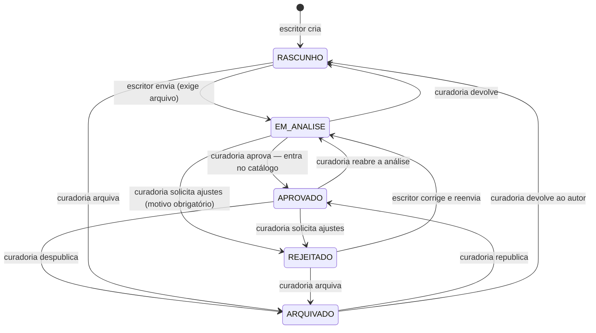

# Regras de negócio

Este documento e `api/src/services/work-policy.ts` descrevem a mesma coisa. Se divergirem, o código é a verdade — e o documento é um defeito a corrigir.

---

## Perfis de usuário

Três perfis, cumulativos: cada um pode tudo do anterior.

| Perfil | Pode |
| --- | --- |
| `LEITOR` | Acessar a plataforma e o catálogo, pesquisar, visualizar livros e quadrinhos, ler as obras disponíveis, avaliar, apoiar o projeto |
| `ESCRITOR` | Tudo do leitor + cadastrar obra, informar título/descrição/autoria/categoria, enviar capa e arquivo, acompanhar o status, enviar para análise |
| `ADMIN` | Tudo do escritor + painel administrativo, analisar obras enviadas, aprovar, rejeitar, gerenciar catálogo, usuários, gêneros, avaliações e apoios |

O que **o leitor não pode**: publicar, aprovar obras, acessar funções administrativas.
O que **o escritor não pode**: aprovar a própria obra ou a de outra pessoa, acessar funções administrativas.

A verificação é feita no servidor (`requireRole` em `api/src/middlewares/auth.ts`), em toda rota. O papel usado na decisão vem **do banco**, recarregado a cada requisição — não do conteúdo do token. Desativar ou rebaixar uma conta tem efeito imediato.

Um leitor ativa o próprio perfil de escritor em **Meu perfil → Quero publicar** (`POST /api/auth/me/writer`). Não é preciso pedir a um administrador. O caminho inverso (rebaixar) é só da administração.

---

## Ciclo editorial de uma obra

### Os cinco status

| Status | Significado | Aparece no catálogo? |
| --- | --- | --- |
| `RASCUNHO` | Em edição pelo autor; pode não ter arquivo ainda | não |
| `EM_ANALISE` | Enviada; a curadoria está avaliando | não |
| `APROVADO` | Aprovada pela curadoria | **sim** |
| `REJEITADO` | Precisa de ajustes; o motivo é mostrado ao autor | não |
| `ARQUIVADO` | Retirada do catálogo | não |

**Aprovar é publicar.** Não existe um estado "publicado" separado nem uma segunda ação do autor: quando a curadoria aprova, a obra entra no catálogo na mesma transação, e `published_at` é preenchido ali (republicar mantém a data original).

> Até a versão 2.0.0 existiam seis estados, e o catálogo mostrava apenas `PUBLICADO`. A curadoria aprovava, o status virava `APROVADO` e a obra **não aparecia** — faltava o autor clicar em "Lançar Agora", em outra tela. Era a causa principal do catálogo vazio relatado. Ver `api/drizzle/0002_aprovado_publica.sql`.

### Efeitos de cada transição

| Entrando em | O que acontece |
| --- | --- |
| `EM_ANALISE` | Exige `file_path`; grava `submitted_at`; cria o checklist da curadoria (ou reabre os itens não aprovados); limpa `rejection_reason` e `reviewed_at` |
| `APROVADO` | Exige `file_path`; grava `reviewed_at`; marca todos os itens do checklist como aprovados; preenche `published_at` se ainda estiver vazio; limpa `rejection_reason` |
| `REJEITADO` | Grava `reviewed_at` e `rejection_reason` (obrigatório: a API recusa rejeitar sem motivo) |
| `ARQUIVADO` | Só muda o status; o histórico e as datas permanecem |
| `RASCUNHO` | Só muda o status |

Uma transição fora do mapa acima é recusada com `409` e a lista do que seria permitido a partir do status atual. `ARQUIVADO → APROVADO` exige que a obra ainda tenha o arquivo original.

### Etapas mostradas ao autor

1. **Recebimento do arquivo** — concluída quando `submitted_at` existe.
2. **Revisão de conteúdo e testes de acessibilidade** — o checklist da curadoria.
3. **Aprovação final** — concluída quando o status é `APROVADO`.

Não há botão de publicar para o autor: a Etapa 3 termina com a obra já no catálogo.

---

## Quem pode editar o quê

| Ação | Autor | Leitor | Admin |
| --- | --- | --- | --- |
| Criar obra | ✅ (perfil escritor) | ❌ `403` | ✅ (em nome de um autor) |
| Editar tudo, inclusive o arquivo | só em `RASCUNHO` / `REJEITADO` | ❌ | ✅ sempre |
| Editar metadados (subtítulo, sinopse, notas, tags, rótulo, capa) | também em `APROVADO` | ❌ | ✅ |
| Editar em `EM_ANALISE` / `ARQUIVADO` | ❌ `403` | ❌ | ✅ |
| Editar a audiodescrição | `RASCUNHO`, `REJEITADO`, `EM_ANALISE` | ❌ | ✅ sempre |
| Enviar para análise | ✅ de `RASCUNHO` / `REJEITADO` | ❌ | ✅ |
| Aprovar, rejeitar, arquivar | ❌ | ❌ | ✅ |
| Excluir | só `RASCUNHO` / `REJEITADO` | ❌ | ✅ qualquer |

Obras não aprovadas respondem `404` — e não `403` — para quem não é o autor nem administrador: o sistema não confirma sequer que a obra existe.

---

## Avaliações

- Só obras aprovadas recebem avaliação.
- Uma avaliação por pessoa e obra; reenviar atualiza a anterior.
- O autor não avalia a própria obra (`409`).
- Nota de 1 a 5, comentário com no mínimo 10 caracteres, recurso avaliado opcional.
- A administração pode ocultar (reversível) ou excluir. Avaliação oculta some da obra, do painel do autor e das médias.

---

## Sessões de leitura

Criadas quando o leitor abre uma obra aprovada, para alimentar as métricas reais dos painéis. Prévias do próprio autor e de obras não aprovadas não contam.

A criação tem limite por IP e devolve um `X-Session-Token`, exigido para atualizar a sessão. Antes a rota de atualização não tinha autenticação nem checagem de dono, e dava para inflar as métricas de fora.

Flags só "ligam": uma vez registrado o uso de audiodescrição, alto contraste, fonte para dislexia ou zoom, o registro permanece.

---

## Apoio voluntário

- Apoiar **nunca** é condição para ler. Nenhuma obra fica atrás de doação.
- Aceito com ou sem conta; com conta, fica vinculado a ela e aparece em "Seus apoios".
- Pode ser vinculado a uma obra ou ao projeto como um todo.
- Valor entre R$ 5,00 e R$ 5.000,00, trafegado e armazenado em **centavos** (inteiro).
- Situações: `PENDENTE` → `CONFIRMADA` / `FALHOU` / `CANCELADA`. Confirmar duas vezes é inofensivo.
- Ninguém confirma nem enxerga o apoio de outra pessoa (resposta `404`).
- Nenhum dado de cartão passa pela aplicação: o provedor devolve um código ou uma URL e o pagamento acontece do lado dele.
- Com o provedor `simulado` (padrão), nenhum dinheiro se move, e a interface diz isso explicitamente.

---

## Gêneros e usuários

- Gênero em uso não pode ser excluído, só desativado — as obras são preservadas.
- Gênero desativado não aparece para novas obras, mas continua válido nas obras existentes.
- Um administrador não pode remover o próprio acesso administrativo nem desativar a própria conta.
- O sistema nunca fica sem pelo menos um administrador ativo.
- Conta com obras não pode ser excluída, só desativada (a chave estrangeira é `RESTRICT`, para preservar o acervo).
- Desativar uma conta bloqueia o login e invalida o token na requisição seguinte.
