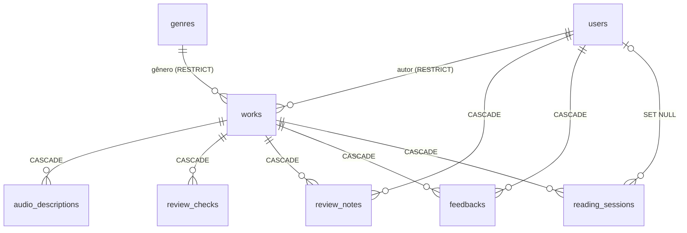

# Banco de dados

PostgreSQL 16, acessado pelo **Drizzle ORM** (`api/src/db/schema.ts` é a fonte da verdade). Todas as consultas são parametrizadas pelo Drizzle.

## Diagrama (ERD)



## Tabelas

### `users` — autores, leitores e administradores
| Coluna | Tipo | Regras |
| --- | --- | --- |
| id | serial | PK |
| name | varchar(120) | obrigatório |
| email | varchar(255) | único (`users_email_unique`), sempre minúsculo |
| password_hash | text | hash bcrypt (nunca a senha) |
| role | enum `user_role` (`LEITOR`, `ESCRITOR`, `ADMIN`) | padrão `LEITOR`, índice |
| plan | enum `user_plan` (`GRATUITO`, `PREMIUM`) | padrão `GRATUITO`. Assinatura simulada: só esconde anúncios. **Não** desbloqueia obra paga |
| is_active | boolean | padrão `true` — desativar = soft delete |
| headline | varchar(160) | apresentação exibida em avaliações/notas |
| last_login_at | timestamptz | atualizado no login |
| created_at / updated_at | timestamptz | automáticos |

### `genres` — gêneros literários
`id` PK, `name` varchar(80) **único**, `slug` varchar(90) **único**, `is_active` (gêneros em uso são desativados, não excluídos), timestamps.

### `works` — obras
| Coluna | Tipo | Observação |
| --- | --- | --- |
| id | serial | PK |
| title / subtitle | varchar(120) / varchar(160) | |
| author_id | int → users.id | **ON DELETE RESTRICT** (usuários com obras não são excluídos) |
| genre_id | int → genres.id | **ON DELETE RESTRICT** |
| format | enum `work_format` (`QUADRINHO`, `LIVRO`, `MANGA_WEBCOMIC`, `ZINE`) | |
| pages | int | `CHECK pages > 0` |
| synopsis | text | |
| status | enum `work_status` (`RASCUNHO`, `EM_ANALISE`, `APROVADO`, `REJEITADO`, `ARQUIVADO`) | índice; `APROVADO` é o estado visível no catálogo |
| edition_label, isbn, age_rating, author_notes | | metadados editoriais |
| monetization | enum `monetization` (`GRATUITA`, `PAGA`, `PUBLICIDADE`) | padrão `GRATUITA` — escolha da autoria |
| price_cents | int | **só existe quando `monetization` é `PAGA`**, de 1 a 5000 (`CHECK works_price_matches_monetization`, nos dois sentidos) |
| ad_revenue_author_share | int | padrão 70, `CHECK` entre 0 e 100. Percentual demonstrativo |
| tags | text[] | padrão `{}` |
| has_audio_desc, has_leitor_tela, has_texto_alt, has_libras, has_facil_leitura, has_alto_contraste | boolean | recursos de acessibilidade |
| audio_describer, audio_narrator, audio_reviewer | varchar | créditos da audiodescrição |
| cover_path, file_path, audio_path | text | caminhos **relativos** ao `UPLOAD_DIR` (não expostos pela API) |
| file_type | enum `file_type` (`PDF`, `EPUB`, `CBZ`, `CBR`, `DOCX`) | `DOCX` foi acrescentado na migração `0005_docx` — valor novo ao fim do enum, sem tocar nos anteriores |
| file_size_bytes, file_original_name | | metadados do arquivo |
| rejection_reason | text | motivo mostrado ao autor |
| submitted_at, reviewed_at, published_at | timestamptz | datas do ciclo editorial |
| created_at / updated_at | timestamptz | |

Índices: `status`, `author_id`, `genre_id`, `published_at`.

### `audio_descriptions` — audiodescrição por página
`work_id` → works (CASCADE), `page_number` (`CHECK > 0`, **único por obra**), `chapter_label`, `chapter_title`, `panel_label`, `description`, `dialogues` **jsonb** (`[{ speaker, tone?, text }]`).

### `review_checks` — checklist da Etapa 2
`work_id` → works (CASCADE), `label`, `status` enum `check_status` (`PENDENTE`, `EM_ANDAMENTO`, `APROVADO`, `REPROVADO`), `position`.

### `review_notes` — notas dos pareceristas e mensagens do autor
`work_id` → works (CASCADE), `user_id` → users (CASCADE), `content`, `created_at`.

### `feedbacks` — avaliações dos leitores
`work_id` → works (CASCADE), `user_id` → users (CASCADE), `rating` (`CHECK 1..5`), `content`, `aspect`, `is_visible` (moderação). **Único por (work_id, user_id)**: reenviar atualiza a avaliação.

### `reading_sessions` — métricas de leitura
`id` **uuid** (gerado pelo banco), `work_id` → works (CASCADE), `user_id` → users (SET NULL, opcional), `last_page`, `used_audio_desc`, `used_high_contrast`, `used_dyslexic_font`, `used_zoom`, `started_at`, `last_activity_at`. Índice (`work_id`, `started_at`).

### `donations` — apoio voluntário ao projeto

| Coluna | Tipo | Observação |
| --- | --- | --- |
| user_id / work_id | int, opcionais | **ON DELETE SET NULL** — apoio anônimo é permitido, e apagar uma obra não apaga o registro financeiro |
| amount_cents | int | `CHECK > 0`. Dinheiro em centavos inteiros, nunca ponto flutuante |
| method | enum `payment_method` (`PIX`, `CARTAO`, `BOLETO`) | |
| provider / provider_ref | varchar | único em conjunto — impede registrar a mesma cobrança duas vezes |
| status | enum `donation_status` | `PENDENTE`, `CONFIRMADA`, `FALHOU`, `CANCELADA` |

Doação **não libera obra nenhuma**: é apoio ao projeto.

### `purchases` — aquisição de obra paga

| Coluna | Tipo | Observação |
| --- | --- | --- |
| user_id | int → users.id | **obrigatório**, ON DELETE CASCADE. A aquisição pertence a uma conta, nunca a um navegador |
| work_id | int → works.id | obrigatório, ON DELETE CASCADE |
| price_cents | int | `CHECK > 0`. **Congelado na compra**: mudar o preço depois não reescreve o histórico de quem já pagou |
| method, provider, provider_ref | | `provider` + `provider_ref` únicos em conjunto |
| status | enum `purchase_status` | `PENDENTE`, `CONFIRMADA`, `FALHOU`, `CANCELADA`, `EXPIRADA` |
| confirmed_at / expires_at | timestamptz | cobrança pendente expira: PIX 30min, cartão 15min, boleto 3 dias |

Dois índices fazem o trabalho pesado:

- `purchases_provider_ref_unique` — a mesma cobrança não entra duas vezes.
- `purchases_one_confirmed_per_user_work` — **índice único parcial**, `WHERE status = 'CONFIRMADA'`. É o que transforma idempotência de promessa em garantia: dois cliques simultâneos não viram duas compras porque o **banco** recusa a segunda, não porque a aplicação lembrou de conferir.

Publicar na estante e adquirir são estados diferentes — por isso esta tabela existe separada de `works` e de `donations`.

## Migrations

- Geradas pelo **drizzle-kit** a partir do schema e versionadas em `api/drizzle/` (SQL puro + `meta/`).
- Aplicadas automaticamente quando o container da API inicia (`npm run start:prod` → `dist/db/migrate.js`). A tabela `drizzle.__drizzle_migrations` registra o que já foi aplicado.

As migrations até aqui:

| | O que fez |
| --- | --- |
| `0000_initial_schema` | Estrutura inicial |
| `0001_tres_papeis` | Três perfis de usuário |
| `0002_aprovado_publica` | Aprovar passa a publicar; `PUBLICADO` aposentado |
| `0003_doacoes` | Tabela `donations` |
| `0004_selo_curadoria` | Selo e checklist |
| `0005_docx` | `DOCX` no enum de formato de arquivo |
| `0006_monetizacao` | Modalidade, preço e a tabela `purchases` |
| `0007_plano_do_leitor` | Coluna `plan` em `users` |

Nenhuma delas é destrutiva: obras existentes ficaram `GRATUITA` e contas existentes ficaram `GRATUITO`, preservando o comportamento anterior.

Alterar o banco:
1. Edite `api/src/db/schema.ts`.
2. `cd api && npm run db:generate` (com `DATABASE_URL` apontando para um banco de desenvolvimento) — gera `drizzle/000X_*.sql`. **Revise o SQL.**
3. `npm run db:migrate` (ou reinicie o container).
4. Faça commit do schema **e** da migration.

## Seed

`api/src/db/seed.ts` é **idempotente** (pode rodar a cada inicialização):
1. insere os gêneros padrão (ignora os existentes);
2. cria o administrador de `ADMIN_EMAIL`/`ADMIN_PASSWORD` se o e-mail ainda não existir;
3. com `SEED_DEMO_DATA=true`, cria (uma única vez) os dados de demonstração: 11 usuários, 13 obras com capas e **obras completas** (`api/seed-assets/`) — contos, poemas e roteiros de quadrinho originais, escritos para o projeto e gerados a partir de `ferramentas/historias/` —, entre elas um manuscrito em `.docx` ainda em análise, audiodescrições, checklists, notas, avaliações e ~400 sessões de leitura para popular as métricas.

## Operações comuns

```bash
# Console SQL
docker compose exec db psql -U livrin_user -d livrin_db

# Resetar tudo (APAGA dados e uploads)
docker compose down -v && docker compose up --build

# Sem Docker (desenvolvimento): recria schema, uploads, migrations e seed
cd api && npm run db:reset
```

Backup/restauração: veja [deployment.md](deployment.md#backup).
